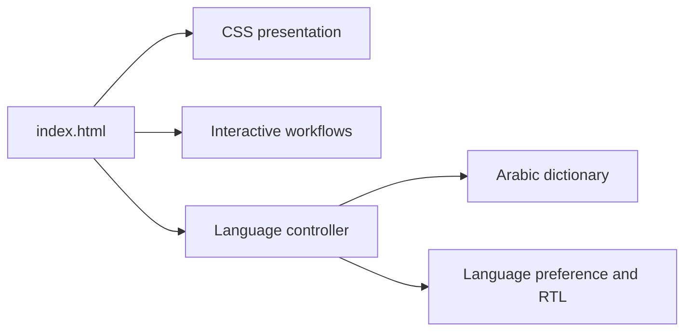

# 👋 Youssef Khaled — Engineering Portfolio

    

A bilingual personal portfolio presenting my experience as a Senior Software Engineer in fintech, financial services, enterprise integrations, and healthcare systems.

**[🌐 GitHub Pages](https://sa5ra2000.github.io/) · [☁️ Cloudflare Pages](https://youssefkhaled.pages.dev/) · [📄 Resume](resume.pdf)**

## ✨ What the website includes

- **Professional profile:** engineering focus, current role, resume, and contact links.
- **Experience timeline:** work across PaySky, Sure Global, Fawry, and nWeave.
- **Selected work:** financing, payment integrations, remittance, vehicle lending, and healthcare applications.
- **Implementation examples:** Keycloak reporting, optimistic concurrency, and installment-status synchronization.
- **Interactive service map:** conceptual connections between customer channels, identity, lending, payments, subscriptions, and downstream services.
- **Workflow explorer:** BNPL, subscription, and remittance scenarios with step controls and playback.
- **English/Arabic switch:** right-to-left layout, translated content, preserved English technical terms, and a saved language preference.
- **Responsive presentation:** layouts for different screen sizes, expandable details, and motion controls.

> [!NOTE]
> Service maps and workflow animations are illustrative. They do not expose a live financial system or a client's internal architecture. This repository contains the portfolio website, not the source code of the employer projects described in it.

## 🧩 How it is built

The site uses plain HTML, CSS, and browser JavaScript. No framework, package installation, backend, or database is required.

```text
index.html        # Content, navigation, sections, and UI structure
style.css         # Visual design, responsive layouts, RTL, animations
interactions.js   # Service map and workflow interactions
translations.js   # Arabic translation dictionary
language.js       # Language switching, text updates, and direction
resume.pdf        # Public downloadable resume
.nojekyll         # Serve the GitHub Pages site without Jekyll processing
```



## 🚀 Preview locally

With Python 3 installed:

```sh
git clone https://github.com/sa5ra2000/sa5ra2000.github.io.git
cd sa5ra2000.github.io
python -m http.server 8765
```

Open `http://localhost:8765/`. Any other static HTTP server can also serve this folder.

## ✏️ Updating content

1. Edit English source content in `index.html` or the interaction definitions in `interactions.js`.
2. Update matching entries in `translations.js`; translation keys depend on the English text.
3. Adjust presentation in `style.css` and replace `resume.pdf` when needed.
4. Check both languages, RTL alignment, narrow-screen layout, workflow controls, and resume/contact links.

When adding technical terms, preserve their spelling in the Arabic copy and verify their display direction.

## ☁️ Deployment

### GitHub Pages

- Repository: `sa5ra2000/sa5ra2000.github.io`.
- Publishing source: the root of `main`.
- Changes committed to `main` trigger the GitHub Pages deployment.
- No application build command is required.

### Cloudflare Pages

- Project: `youssefkhaled`.
- The current deployment uses **Direct Upload** of the static site files.
- GitHub commits do **not** automatically update this Cloudflare project.
- To refresh it, upload a new production deployment containing `index.html`, the CSS/JavaScript files, and `resume.pdf` at the archive root. Exclude `.git` and development-only files.

## 📍 Current stage

- [x] Publish the portfolio on GitHub Pages and Cloudflare Pages.
- [x] Add English/Arabic switching and RTL support.
- [x] Add interactive financial-service illustrations and workflows.
- [x] Publish contact details and a downloadable resume.
- [ ] Add automated checks for content, links, and translations.
- [ ] Automate deployment updates to both hosting providers.

The published pages and language switch were checked in a browser during deployment. There is no automated test suite in this repository. The remaining checklist items are proposed improvements.
